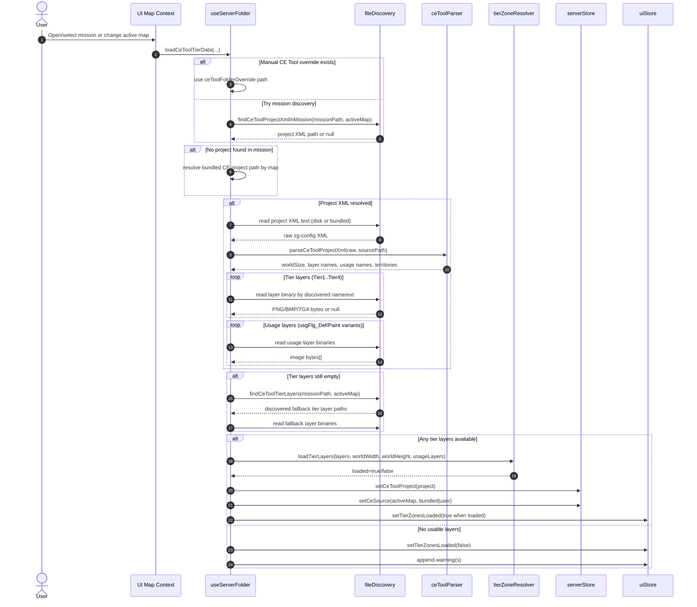

# CE Tool Tier and Zone Loading Sequence

Focused sequence for how CE Tool project metadata and layer assets are discovered, parsed, and turned into map-ready tier and usage overlays.

## Notes

- Source priority is user override -> mission-local CE Tool project -> bundled CE Tool project.
- World size for raster mapping is taken from parsed CE project when available.
- Loading usage layers is additive; missing usage layers do not block tier loading.
- Compatibility/warning behavior is non-fatal and surfaced in UI notices.

## Source Anchors

- src/hooks/useServerFolder.ts
- src/lib/fileDiscovery.ts
- src/lib/ceToolParser.ts
- src/lib/tierZoneResolver.ts
- src/store/serverStore.ts
- src/store/uiStore.ts
