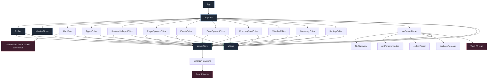

# Component Dependency Map

Compact map of major React components, hooks, stores, and parsing/services used by the app shell and editor tabs.

## Read It Like This

- AppShell is the composition root for top-level UI and lazy tab mounting.
- useServerFolder is the data-ingest orchestrator and the main bridge between discovery/parsing and stores.
- serverStore carries editable mission domain state and save logic; uiStore carries filters, active tab/map, and UX state.
- Editors are store-driven and mostly avoid direct file IO.

## Source Anchors

- src/App.tsx
- src/components/layout/AppShell.tsx
- src/components/layout/TopBar.tsx
- src/hooks/useServerFolder.ts
- src/store/serverStore.ts
- src/store/uiStore.ts
- src/lib/fileDiscovery.ts
- src/lib/xmlParser/index.ts
- src/lib/ceToolParser.ts
