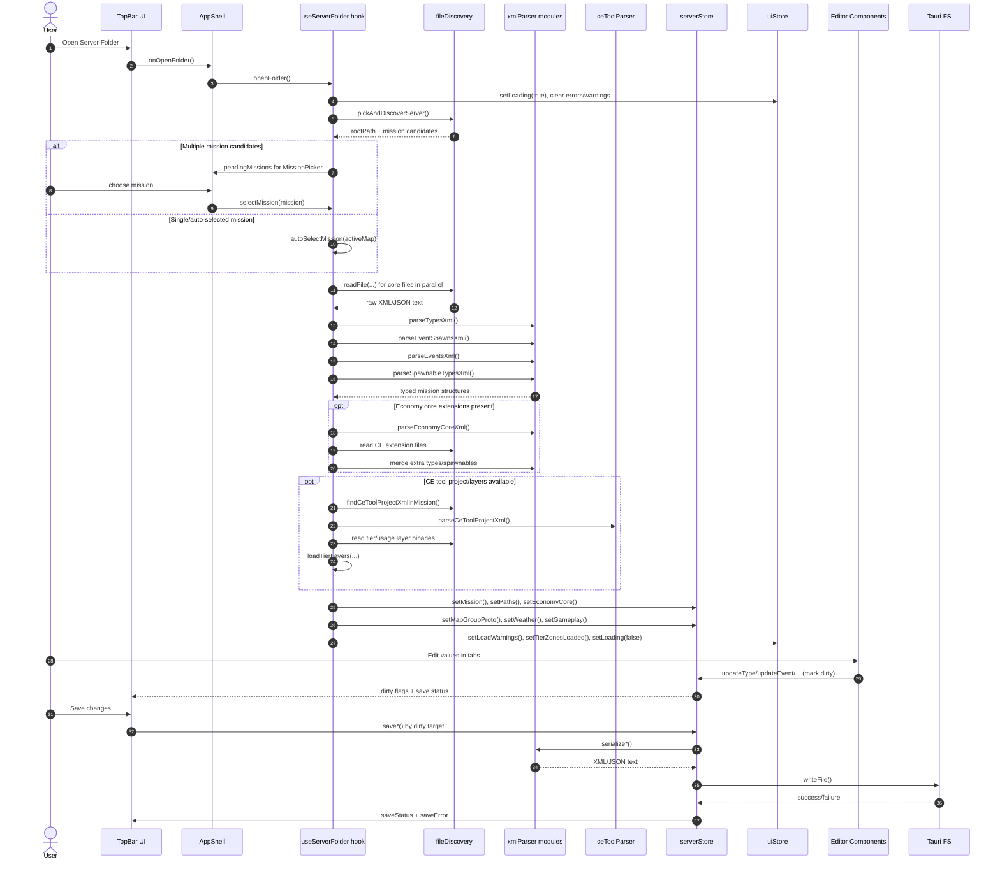

# Open Folder to Save Sequence

This sequence maps the main runtime path from selecting a server folder through parsing, editing, and persisting changes.

## Key Boundaries

- Orchestration: useServerFolder
- Parsing/serialization: xmlParser and ceToolParser
- Domain state and persistence: serverStore
- View state and UX controls: uiStore + AppShell + TopBar
- Disk IO boundary: Tauri FS plugins

## Primary Source Files

- src/hooks/useServerFolder.ts
- src/lib/fileDiscovery.ts
- src/lib/xmlParser/index.ts
- src/lib/ceToolParser.ts
- src/store/serverStore.ts
- src/store/uiStore.ts
- src/components/layout/AppShell.tsx
- src/components/layout/TopBar.tsx
